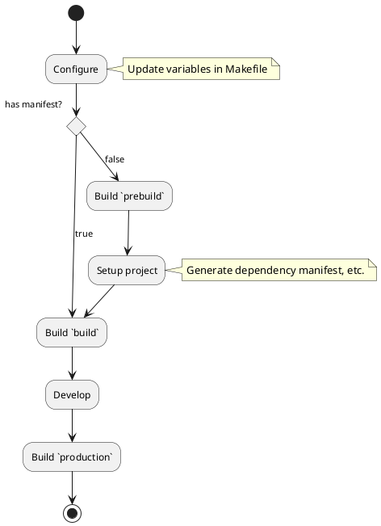

# Docker Setup for Python Application
This template for a Python application packaged into a Docker container follows
several best practices in order to result to production images that
- use non-root users
- use build-stages to minimize image size

## Usage
The [Makefile](Makefile) defines the following rules:
- `bash`
- `clean`
- `image`

The Makefile extracts its configurations from variables for which it contains
definitions. When available, the Makefile imports the project.mk file at a
stage when most variables are already defined in order to offer an opportunity
for overrides. Some of the available variables and some descriptions are listed
below and are further documented in the [Makefile](Makefile):
- `srcdir`
- `workdir`
- `Dockerfile`
- `stage`
- `PROJECT_NAME`, the name of the project and the name of the Docker image
- `PROJECT_VERSION`, the version of the project which defaults to the result of
  `git describe --always --dirty` and is used to tag Docker images
- `SYSTEM_PACKAGES`
- `RUNTIME_VERSION`
- `PACKAGE_INSTALLER`
- `PACKAGE_INSTALLER_VERSION`
- `DOCKER_REGISTRY`
- `DOCKER_CONTAINER_EXPOSE_PORTS`, which ports are exposed using the `EXPOSE`
  instruction when building the production image
- `DOCKER_CONTAINER_PORT_MAPPING`, which port mapping arguments to pass along
  to `docker run` based on `DOCKER_CONTAINER_PORTS`, by mapping every listed
  `PORT` to `--publish $(HOST):$(PORT)`

> :bulb: Do not commit the project.mk file as it allows developers to define
> workspace-specific configurations. Project-wise configuration changes should
> be made by updating the variable definitions in the [Makefile](Makefile).

The following steps roughly outline how to use this configuration:



1. Update the variables in Makefile in to reflect the desired configuration

2. Run `make image stage=prebuild` to [build](#build-images) the "prebuild"
   image which will contain the OS, the system packages and the Python package
   manager.

   > :warning: The prebuild stage is designed to be used when a configuration
   > lacks some of the needed assets to complete the installation of Python
   > packages. When starting a brand new project, for example, there is no
   > manifest to inform a package installer about what to install.

3. Once the `prebuild` image is build, enter it through `make bash
   stage=prebuild` in order to [run commands](#run-commands) to generate a
   dependency manifest by running `poetry new`, for example.

4. With the dependency manifest available, run `make image stage=build` to
   start a Docker environment that can be used as a development environment.

5. Enter the `build` image through `make bash stage=build` in order to install
   Python packages and run the application, tests or other tools.

6. Run `make image stage=production` to build a "production" image

   > :bulb: This stage is typically built in a CI/CD pipeline.

### Build images
In [Dockerfile](Dockerfile), the following stages are defined:

- `prebuild`, the base image with system packages and Python package manager
  installed

- `build`, the `prebuild` image with the Python packages installed

- `production`, the base image with a production-safe user account configured
  and the system packages and virtual environment copied into it

  > Build images can contain "noise" such as cache files that may not be needed
  > in production images. The "production" image is therefore not based on the
  > "build" image but rather on the cleaner "base" image. This design allows
  > one to be more explicit[^explicit] about that which is copied into a
  > production image.

  [^explicit]: By basing target images on build images using the `FROM`
  instruction , we risk including numerous noisy artefacts to find their way
  into the production image. Build images contain cache files, among other
  artefacts, that are non-productive side effects of installation and may
  therefore not add any value to a target image. Being explicit about copying
  files from the build images reduces the opportunity for non-wanted files to
  silently get included into build.


#### Base Image
Both images are built on top of one of the official Python images as the base
image. By setting `BASE_IMAGE`, one may alter the base image used in both the
development and the production images.

```bash
BASE_IMAGE=python:3.8.0-slim make prod-image
```

#### Caching
To avoid rebuilding all images from scratch, ensure that `DOCKER_CACHE_FLAG=""`
is empty before calling `make image`.

```bash
DOCKER_CACHE_FLAG="" make image
```

> `DOCKER_CACHE_FLAG`, by default, is set to `--no-cache` (the argument to
> disable caching when calling `docker build `).

#### Application Path
Use `APP_PATH`, which defaults to `.`, to specify the application path. With the
application and the package manifest located in subdirectory `subdir`, run
`APP_PATH=subdir make image` to produce a Docker image.

### Run commands
In order to produce a Bash shell from which to run arbitrary commands, run
`make bash`.

### Clean environment
Run `make clean` to remove the venv directory and the caches in order to start
from a clean slate.

> When using pip, it may help to clean the environment before running `pip
> install` in development shell in order to avoid situations where setups seem
> to be running locally because of the state of the cache that may not be
> captured by the requirements.txt file. This could help in detecting failing
> builds before they become the problem of colleagues or CI/CD pipelines.
