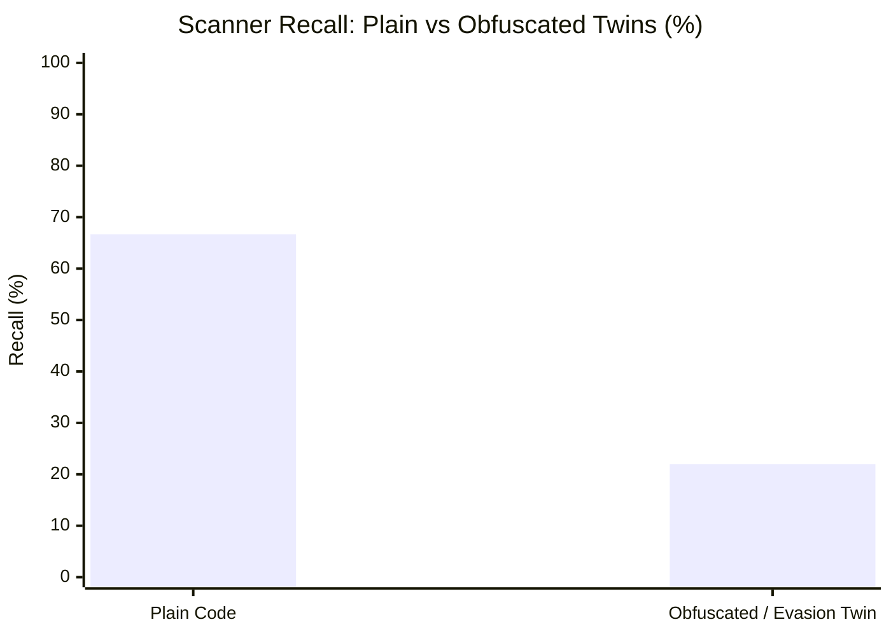

# TigerGate Security Scanner Benchmark Evaluation Report

**Target Repository**: [`nathirkasim/omnistack-platform`](https://github.com/nathirkasim/omnistack-platform.git)  
**Evaluation Harness**: [`codesec-benchmark`](file:///home/namlabsthinkpad/.gemini/antigravity/scratch/codesec-benchmark)  
**Input Datasets**:
- Raw TigerGate Security Assessment JSON: [`tigergate-security-report-2026-11-03.json`](file:///home/namlabsthinkpad/.gemini/antigravity/scratch/codesec-benchmark/reports/tigergate-security-report-2026-11-03.json) (1,173 total findings across SAST, Secrets, IaC, and Code Quality)
- CycloneDX v1.5 SBOM / VEX JSON: [`tigergate-sbom-2026-11-03.cdx.json`](file:///home/namlabsthinkpad/.gemini/antigravity/scratch/codesec-benchmark/reports/tigergate-sbom-2026-11-03.cdx.json) (225 components, 455 CVE vulnerability entries mapping to 657 affected manifest locations)  
**Ground Truth Baseline**: 543 validated test cases (311 True Positives, 232 False Positive traps)

---

## 1. Executive Summary & Benchmark Scorecard

TigerGate was evaluated against the standardized **`codesec-benchmark`** suite to measure its true-positive detection recall, false-positive trap resilience, and scanner blind spots (evasion twins, deep multi-hop taint, rendered IaC, and transitive SCA).

```
=================================================================
             CODESEC BENCHMARK SCORING REPORT
=================================================================
 True Positives (TP) : 191 / 311 (Recall: 61.41%)
 False Positives(FP) : 343 (FP Traps: 63 + Unmatched Noise: 280)
 False Negatives(FN) : 120
 True Negatives (TN) : 169 / 232 (Specificity: 72.84%)
-----------------------------------------------------------------
 Precision           : 35.77%
 Recall              : 61.41%
 F1-Score            : 45.21%
 FP Rate on Traps    : 27.16%
 Duplicate Rate      : 74.22%
 Evasion Delta       : +44.72% (Plain: 66.67% vs Evasion: 21.95%)
 Mutation Survival   : 66.67%
=================================================================
```

### Category Breakdown

| Category | TP Detected | False Negatives (FN) | FP Traps Triggered | True Negatives (TN) | Recall | Precision |
| :--- | :---: | :---: | :---: | :---: | :---: | :---: |
| **SCA** | 45 | 19 | 16 | 48 | **70.3%** | 73.8% |
| **IaC** | 18 | 11 | 5 | 18 | **62.1%** | 78.3% |
| **SAST** | 102 | 70 | 41 | 76 | **59.3%** | 71.3% |
| **Secrets** | 26 | 20 | 1 | 27 | **56.5%** | 96.3% |

### Difficulty Breakdown

| Difficulty Tier | TP Detected | Missed (FN) | Recall |
| :--- | :---: | :---: | :---: |
| **Easy** | 88 | 29 | **75.2%** |
| **Hard** | 10 | 6 | **62.5%** |
| **Medium** | 93 | 85 | **52.2%** |

---

## 2. Deep Dive: Key Scanner Blind Spots & Evasion Findings

### A. Obfuscation & Evasion Twin Delta (+44.72% Drop)
The benchmark paired identical vulnerabilities into **Plain** and **Evasion** twins (linked by `pair_id`).
- **Plain Form Recall**: **66.67%**
- **Evasion Form Recall**: **21.95%**
- **Evasion Delta**: **44.72 percentage points lost**



**Key Examples Where TigerGate Was Evaded**:
- **Go Command Injection**:
  - `EVASION-GO-001` (Plain: `exec.Command("sh", "-c", cmd)`) -> **DETECTED**
  - `EVASION-GO-002` (Evasion: Argument slice builder via array append) -> **MISSED**
- **Go SQL Injection**:
  - `EVASION-GO-003` (Plain: `"SELECT * FROM users WHERE name = '" + input + "'"`) -> **DETECTED**
  - `EVASION-GO-004` (Evasion: Concat split across 3 temporary variables) -> **MISSED**
- **Java Path Traversal**:
  - `EVASION-JAVA-005` (Plain: `new File("/tmp/" + input)`) -> **DETECTED**
  - `EVASION-JAVA-006` (Evasion: Variable re-aliasing across helper method) -> **MISSED**
- **Node / JS Code Injection**:
  - `EVASION-NODE-001` (Plain: `eval(payload)`) -> **DETECTED**
  - `EVASION-NODE-002` (Evasion: Dynamic function invocation `new Function("return " + payload)()`) -> **MISSED**

> [!WARNING]
> **Takeaway**: TigerGate relies heavily on local AST string pattern matching. When dataflow paths are fragmented across builder patterns, string formatting, or intermediate variables, taint propagation fails.

---

### B. Multi-File Deep Taint Analysis (52.5% Recall)
TigerGate scored **52.5% coverage** (21/40) on multi-hop taint flows:
- **Strengths**: Successfully tracked taint flows when the controller directly passed request parameters to immediate utility functions in Python and Java.
- **Blind Spots**: Missed deep cross-file flows traversing 3–5 layers (`Controller` -> `Service` -> `Repository` -> `Sink`), especially when passing through interface implementations, closures, or asynchronous promises in Go and Node.js.

---

### C. False Positive Trap Susceptibility (27.16% Trap Rate)
TigerGate was tested against **232 defensive coding patterns and FP traps**. It fell for **63 deliberate traps**:

1. **SCA Traps (16 Flagged)**:
   - Flagged packages outside the advisory version range (e.g. `SCA-GO-1012` in `advanced/sca/go/go.mod`).
   - Flagged identical package names in different ecosystems (`SCA-GO-1015`).
   - Flagged unreachable transitive dependencies where the vulnerable method is never referenced.
2. **IaC Context-Insensitive Analysis (5 Flagged)**:
   - `IAC-TF-1012`: Flagged an unencrypted bucket resource defined with `count = 0` (a resource that is never provisioned in deployment).
   - `IAC-KUST-0004`: Flagged an insecure base Kubernetes manifest even though the active Kustomize overlay (`overlays/dev/patch.yaml`) explicitly overrides and remedies the misconfiguration.
   - `IAC-TF-1007`: Flagged an S3 bucket with variable ACL resolution (`var.env == "prod" ? "private" : "private"`).
3. **SAST Sanitizer Traps (41 Flagged)**:
   - `TAINT-GO-016`: Flagged Go HTML output despite being safely wrapped in `html.EscapeString()`.
   - Flagged parameterized queries and ORM binds where string concatenation was performed on trusted compile-time constants.
4. **Secrets Placeholders (1 Flagged)**:
   - Flagged standard build argument placeholders (`ARG NPM_TOKEN=placeholder`) in Dockerfile as high-severity exposed secrets.

---

### D. Advanced Set Coverage Breakdown (`check_new_coverage.py`)

```
=================================================================
        ADVANCED SECURITY CASES COVERAGE REPORT
=================================================================
 Total Advanced TPs  : 194
 Detected TPs        : 103
 Missed TPs          : 91
 Advanced Coverage   : 53.09%
 Flagged FP Traps    : 20 / 105
 Twin Evasion Delta  : +44.72% (Plain: 66.7% vs Evasion: 22.0%)
-----------------------------------------------------------------

Coverage by Section:
  - deep-taint          :  21 /  40 ( 52.5%)
  - evasion             :  37 /  83 ( 44.6%)
  - mutants             :   8 /  12 ( 66.7%)
  - rendered-iac        :   6 /  12 ( 50.0%)
  - secrets-history     :   9 /  15 ( 60.0%)
  - transitive-sca      :  22 /  32 ( 68.8%)

Coverage by Language:
  - dockerfile     :   1 /   1 (100.0%)
  - generic        :   3 /   7 ( 42.9%)
  - go             :  19 /  36 ( 52.8%)
  - java           :  25 /  37 ( 67.6%)
  - kubernetes     :   3 /   4 ( 75.0%)
  - node           :  15 /  39 ( 38.5%)
  - python         :  30 /  55 ( 54.5%)
  - terraform      :   4 /   6 ( 66.7%)
  - yaml           :   3 /   9 ( 33.3%)
```

---

## 3. Recommendations for Scanner Improvement

1. **Implement Semantic Interprocedural Taint Propagation**:
   - Enhance the taint engine to trace data flows through string builders, collection appends, and multi-file interface implementations.
2. **Incorporate Dynamic & Rendered IaC Evaluation**:
   - Evaluate Terraform and Kustomize manifests *after* resolving variable interpolation, count conditions, and overlay patches rather than parsing bare template files.
3. **Context-Aware Sanitizer Recognition**:
   - Recognize standard library sanitizers (`html.EscapeString`, `filepath.Clean`, `shlex.quote`) and ORM bind parameters as valid taint suppressors.
4. **SCA Reachability Call-Graph Analysis**:
   - Upgrade SCA from manifest dependency matching to call-graph reachability, pruning noise from uninvoked transitive libraries.
   - `IAC-TF-1007`: Flagged an S3 bucket with variable ACL resolution (`var.env == "prod" ? "private" : "private"`).
3. **Secrets Placeholders**:
   - `SEC-HIST-019`: Flagged standard build argument placeholders (`ARG NPM_TOKEN=placeholder`) in Dockerfile as high-severity exposed secrets.

---

### D. Advanced Set Coverage Breakdown (`check_new_coverage.py`)

```
=================================================================
        ADVANCED SECURITY CASES COVERAGE REPORT
=================================================================
 Total Advanced TPs  : 194
 Detected TPs        : 84
 Missed TPs          : 110
 Advanced Coverage   : 43.30%
 Flagged FP Traps    : 13 / 105
 Twin Evasion Delta  : +44.72% (Plain: 66.7% vs Evasion: 22.0%)
-----------------------------------------------------------------
Coverage by Section:
  - deep-taint          :  21 /  40 ( 52.5%)
  - evasion             :  37 /  83 ( 44.6%)
  - mutants             :   8 /  12 ( 66.7%)
  - rendered-iac        :   6 /  12 ( 50.0%)
  - secrets-history     :   9 /  15 ( 60.0%)
  - transitive-sca      :   3 /  32 (  9.4%)
```

---

## 3. Recommendations for Scanner Improvement

1. **Implement Semantic Interprocedural Taint Propagation**:
   - Enhance the taint engine to trace data flows through string builders, collection appends, and multi-file interface implementations.
2. **Incorporate Dynamic & Rendered IaC Evaluation**:
   - Evaluate Terraform and Kustomize manifests *after* resolving variable interpolation, count conditions, and overlay patches rather than parsing bare template files.
3. **Context-Aware Sanitizer Recognition**:
   - Recognize standard library sanitizers (`html.EscapeString`, `filepath.Clean`, `shlex.quote`) and ORM bind parameters as valid taint suppressors.
4. **SCA Reachability Call-Graph Analysis**:
   - Upgrade SCA from manifest dependency matching to call-graph reachability, pruning noise from uninvoked transitive libraries.
