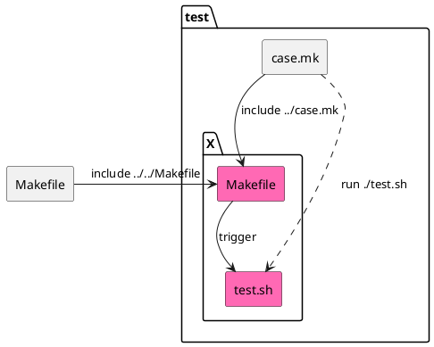

# Tests for Docker Setup for Python Apps

This configuration builds Docker images for a few test Python projects in order
to verify that the builds at least complete. The assumption is that all builds
succeeding is a strong indicator of this configuration working "well enough"
for its intended use-cases.


## Usage

Run all the tests by running entering the `test` directory and executing the
following command:

```sh
make tests
```

From every subdirectory of the `test` directory, the following makerules can be
executed to test the configuration:

- `make src`, to clone the test project
- `make test`, to perform a Docker image build based on the source of the test
  Project
- `make clean-src`, to clean up the cloned sourced from the `make src` step

The `src`, `test` and `clean-src` rules are defined in the
[test/case.mk](case.mk) file and included by the Makefile within a test
directory.

Note how the Makefile inside the test case directory simply imports the project
root Makefile along with the case.mk.


## Add New Test

Complete the following steps to add a new project to the tests:

1. Create an appropriately named subdirectory in `test`, where we assume `X` as
   the name of the created subdirectory

2. Populate `test/X/Makefile` to
   1. include `Makefile` and the `image` rule contained therein

      > :warn: Including `Makefile` requires that the variables, for which
      > default values are not appropriate, are set.

   2. include `test/case.mk` and the `src`, `test` and `clean-src` rules
      defined therein

      > :warn: Including `test/case.mk` requires that the variables `REPO_URL`
      > and `REPO_BRANCH_NAME` are appropriately set.

3. Populate `test/X/test.sh` to appropriately call `make image` which has
   been imported in step 2.1.


## Anatomy of a Test Setup

For a given test to work, a Makefile and test.sh will need to be provided.

For convenience sake, the [test/case.mk](case.mk) provides a test interface in
the form of helper make rules. These rules can be included in a Makefile local
to the test where test-specific variables are defined.



See [`djanjo-realworld-example-app`](djanjo-realworld-example-app) as a
reference.

### Makefile

The Makefile is responsible for defining the make rules listed in the
[Usage](#usage) section (`src`, `test`, `clean-src`). As these rules are
defined in the [test/case.mk](case.mk) file, they can simply be included. The
Makefile is mostly used to provide the needed variable definitions to reflect
the configuration for the given test.

> :warning: GNU Make handles paths from the perspective of the directory where
> the `make` command is invoked. In order for some path-defining variables
> (such as `srcdir` and `Dockerfile`) to hold valid values when make is called
> from a different directory, they will need to be redefined.

Observe how, in the snippet below, `Dockerfile` and `srcdir` have been
configured to point GNU Make towards the correct Dockerfile in the repository
root and the `src` directory in the current directory, respectively.

> :bulb: It may not be necessary to override variables by defining them after
> the `include` commands because some variables have been assigned with the
> `?=` operator which sets default values when the variables are undefined. By
> defining the needed variables before the include, there will be no need for
> the included files to default to their default values.

```make
RUNTIME_VERSION ?= 3.8.0

srcdir = ./src
Dockerfile = ../../Dockerfile

PACKAGE_INSTALLER = pip install -r requirements.txt

-include ../../Makefile


REPO_URL = https://github.com/gothinkster/django-realworld-example-app.git

-include ../case.mk
```

### test.sh

The test.sh is used to specify the `make image` command that is used to build
the wanted Docker image.

```sh
#! /usr/bin/env sh
set -eux

make image stage=build
```
